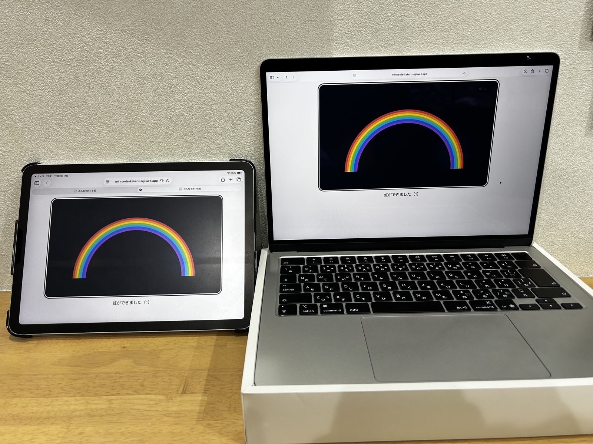

# みんなでかける虹

ちがう動きが、ひとつの虹になる。



デモ動画：https://www.youtube.com/watch?v=BYpMC6gRlEw

二人の子どもが別々の端末から働きかけ、一つの虹を完成させる共同制作Webアプリです。一人が何度・どれだけ速く操作しても、もう一人が一度も働きかけなければ、虹は完成しません。操作能力の差を、参加価値の差に変換しない——この考え方を「対等参加プロトコル」と呼び、作品の中心に置きました。

「みんなでかける虹」は、Built with Claude: Japan 2026 のために開発した作品です。

## 公開URL

https://minna-de-kakeru-niji.web.app

ブラウザで開くだけで使えます。会員登録は不要で、インストールも要りません。

## 試し方

### 3台の端末で試す（基本の形）

先生役の端末1台と、子ども役の端末2台を使います。先生役1人と、子ども役2人（端末2台）で試します。

1. 先生役の端末で公開URLを開き、「部屋をつくる（先生）」を押して部屋を作成します
2. 先生画面に表示される参加用リンクを、子ども役の2台の端末で開きます（リンクを開くと、参加希望が先生画面に届きます）
3. 先生画面で、参加希望を一人ずつ承認します。承認すると、空いている役割（AまたはB）に割り当てられます
4. 子どもAが操作すると暖色の光、子どもBが操作すると寒色の光が出ます。両方が一度ずつ操作すると、虹が完成します
5. 完成した後も、二人が一度ずつ操作するたびに、共同の変化が繰り返し起きます
6. 終わるときは、先生画面の「活動を終える」で部屋を終了できます

### 1台のPCで試す

端末が1台だけでも試せます。本番サイトでこの方法で試せることを確認済みです。

1. ブラウザの通常ウィンドウで公開URLを開き、先生として部屋を作成します
2. 参加用リンクを、同じブラウザのプライベート（シークレット）ウィンドウと、別のブラウザまたは別プロフィールで開きます。それぞれが別の参加者として扱われ、子どもA・子どもBの2画面になります
3. 先生のウィンドウで2人を承認し、2つの子どもウィンドウで一度ずつ操作すると、虹が完成します

### 注意

- 部屋は作成から最大3時間で期限切れになり、期限を過ぎると読み書きできなくなります。試すたびに、新しい部屋を作成してください
- 終了した部屋の参加用リンクは使えません
- 声について：端末をまだ操作していない状態では、最初の声が再生されないことがあります（ブラウザの仕様です）。参加を待つ画面で一度タップしておくと、その後の声が再生されます。このタップは参加には数えられません
- 参加の解除について：一度承認した子を解除して再度承認すると、参加の回数は前の続きから始まります。別の生徒に変わるときは、活動を終えて新しい部屋を作ってください

## 子ども画面の表示

子ども画面では、言葉よりも光の動きで状態を伝えます。自分の光は呼吸するようにゆっくりと明るさが変化し、相手の光はそっと揺れます。急速な点滅は使いません。言葉は補助として、次の4つだけを使います。声も、同じ言葉を開発者本人の録音で伝えます。

- 「ひかりを だそう」（最初の状態。文字のみ）
- 「ひかったね」（自分の参加が保持されたとき）
- 「あなたの ばんだよ」（相手の参加が届いているとき）
- 「にじが できたよ」（虹が完成したとき）

光は、強い刺激を避けるため、柔らかく滲む表現にしています。急速な点滅は使わず、変化はゆっくりです。完成した虹は薄い層として後ろに残ります。二人の参加が積み重なっていく様子を表しています。

## 入力方法と支援技術

次の入力方法に対応し、いずれも実機で動作を確認しました。

- タッチ
- スワイプ
- キーボード
- Bluetoothスイッチ（SpaceやEnterなどのキーを送る機器。AbleNet Blue2 で確認）
- 視線入力（Tobii。Windows端末で確認）

支援技術では、次でも操作できることを実機で確認しました。

- スイッチコントロール（iPad）
- VoiceOver（iPad）

学校のネットワークでも、2台のiPadを使って問題なく動作することを確認しています。

## 技術構成

- HTML / CSS / JavaScript
- Firebase Realtime Database（asia-southeast1）：リアルタイム同期
- Firebase Anonymous Authentication：匿名認証
- Firebase Realtime Database Security Rules：権限と状態遷移をサーバー側で検証
- Firebase Hosting：公開

同期方式は「min方式」です。子どもAとBが各自の参加回数（単調増加カウンタ）だけを持ち、共同成立回数は小さい方の値で決まります。一人が先行して何度操作しても、未組み合わせの参加は1件までしか保持されません。この判定は、クライアント側の処理と Security Rules のサーバー側検証の両方で行っています。

## セキュリティと個人情報

- 児童生徒の氏名、顔写真、メールアドレスなどの個人情報は収集しません。保持するのは活動に必要な最小限の状態だけです
- 部屋IDは推測が困難な形式です。参加は教員の承認制で、未承認の利用者は活動データを読み書きできません
- 子どもは自分のカウンタだけを更新できます。他の参加者のカウンタや役割は変更できません（Security Rules で検証）
- 教員の権限は、参加の承認・解除、音声の設定、活動の終了などの管理に限られ、子どものカウンタには書き込めません
- 部屋は作成から最大3時間で期限切れとなり、それ以降の読み書きは拒否されます
- 教員が活動を終えると、終了したことが明示され（meta/endedAt）、データは削除されます
- 自動テストとして、Security Rules のテスト51件とクライアントテスト30件を作成し、全件通過を確認しています

## 開発について

- Built with Claude: Japan 2026 の開催期間（2026年11月2日〜8日）に、新規リポジトリでゼロから開発しました。既存プロジェクトのコードは流用していません
- 企画・設計の資料（設計メモ）は開催前に作成したものです（運営の案内に従い、ここに明記します）。コードは、すべて開催期間中に新しく書きました
- 開発者は、コードを書かない現役の特別支援学校教員です。Claude Code を中心に据えて実装を進め、設計と教育的な判断は教員自身が行いました
- Claude への依頼内容、提案の採用・不採用の判断と理由、実装とテストの結果は、開発記録（[docs/dev-log.md](docs/dev-log.md)）としてこのリポジトリに残しています
- 開発中、教員が子どものカウンタを書き換えられてしまう権限の穴をテストで発見し、教員の権限を管理だけに限るように修正しました。この修正には回帰テスト（A19）を残しています
- Security Rules を意図的に弱めて再実行する変異確認を行い、弱めた箇所をテストが検出できること（A19・A23・D9 が失敗）と、二重の防御により別の条件で拒否されるもの（A22・D11）があることを確認しました
- 音声は開発者本人の録音です。合成音声は使っていません

## 今後の展望

一人ひとりの障害特性や発達段階に合わせて細かく設定できるよう、アクセシビリティの詳細設定を充実させていく予定です。光の強さの調整や全画面表示など、使う子に合わせて選べる設定を増やしていきます。また、開発者が運営する無料教材サイト「どのまな」での紹介を予定しています。

## 開発者向け

### テストの実行方法

前提ソフト：Node.js（npm を含む）、Firebase CLI（`firebase` コマンド）、Java（Rules テストで使う Realtime Database エミュレータに必要）。

```
npm install
npm run test:rules    # Security Rules のテスト（tests/rules.test.js、エミュレータ上で実行）
npm run test:client   # クライアントの判定ロジックのテスト（tests/client.test.js）
```

テストの本体：[tests/rules.test.js](tests/rules.test.js)、[tests/client.test.js](tests/client.test.js)

### 資料

- [docs/dev-log.md](docs/dev-log.md)：開発記録。Claude への依頼、提案の採用・不採用の判断と理由、実装とテストの結果
- [docs/rules-inventory.md](docs/rules-inventory.md)：Rules テストの棚卸し。担保が欠けていた操作の洗い出しと、Rules を弱めた変異確認の詳細
- [docs/report-2026-11-02.md](docs/report-2026-11-02.md)：11月2日夜の報告。提案内容と承認、当日のテスト結果
- [docs/network-domains.md](docs/network-domains.md)：通信先ドメインの一覧。学校のネットワークで許可が必要な接続先
- [docs/closed-screen-investigation.md](docs/closed-screen-investigation.md)：初回に終了画面が出た件の調査記録
